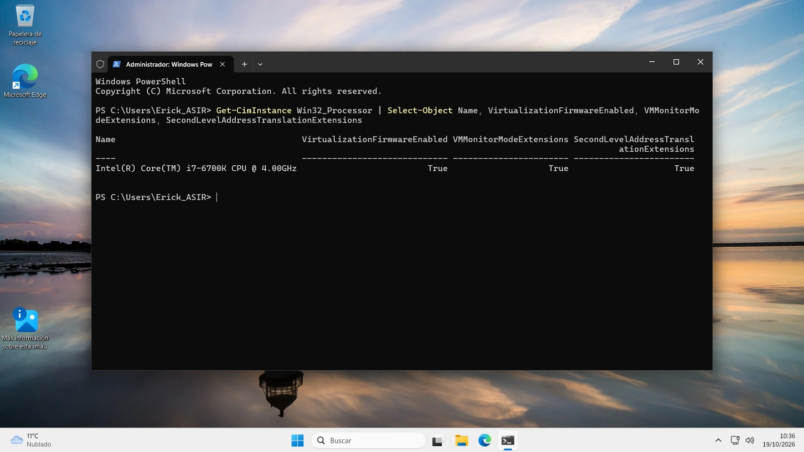
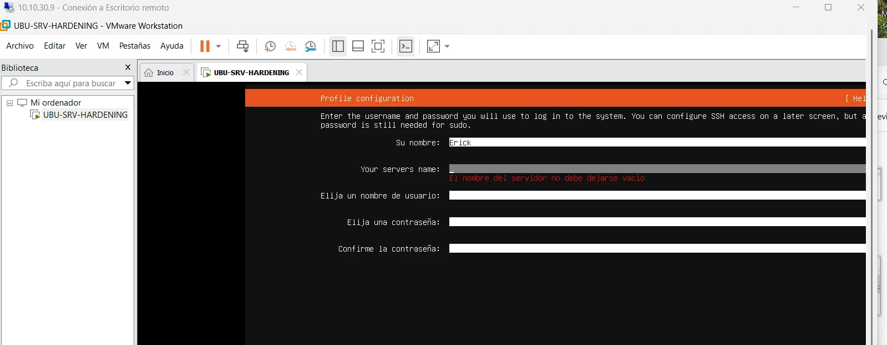
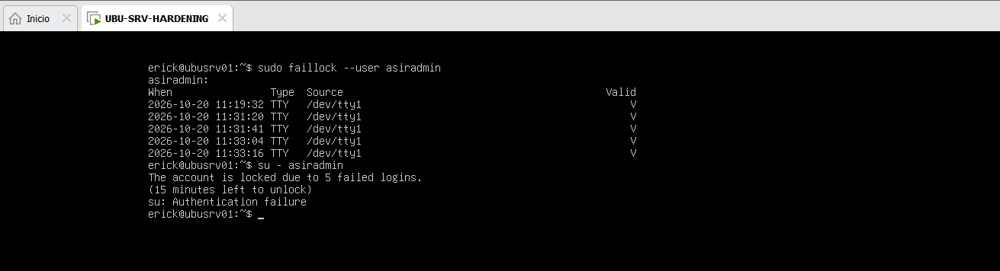
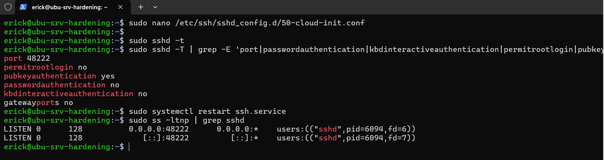
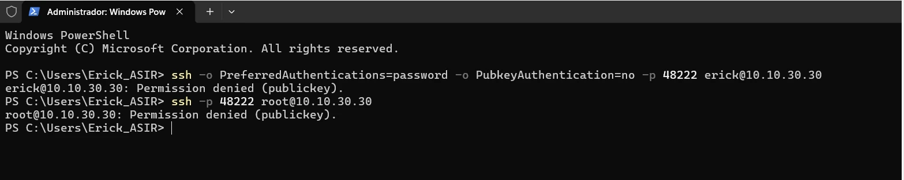
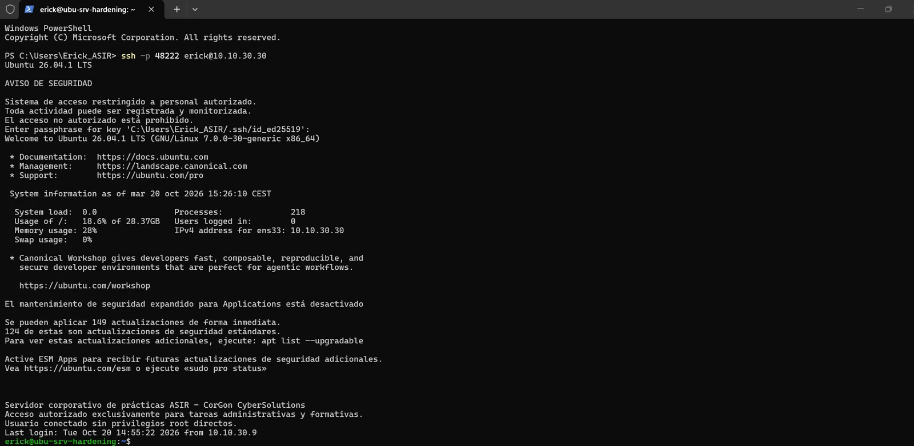
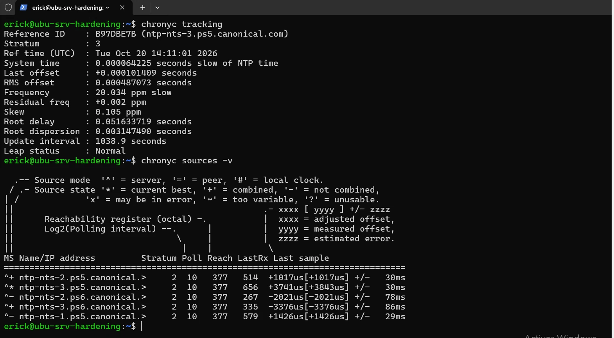
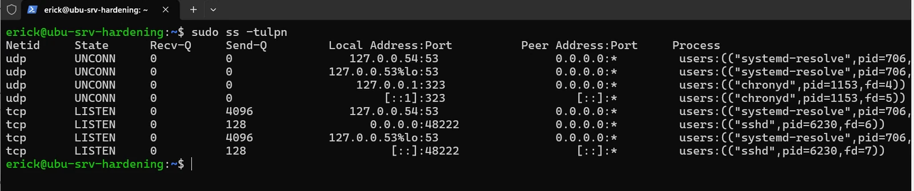

# Evidencias visuales

Esta carpeta contiene una selección de las evidencias más representativas del laboratorio de despliegue y hardening de Ubuntu Server.

El objetivo es mostrar de forma visual que las configuraciones documentadas fueron comprobadas realmente en el entorno de laboratorio.

## 1. Virtualización anidada



Verificación de que la máquina Windows 11 recibe correctamente las extensiones necesarias para ejecutar virtualización anidada.

---

## 2. VMware ejecutando Ubuntu Server



VMware Workstation ejecutando correctamente la máquina Ubuntu Server dentro del entorno virtualizado.

---

## 3. Bloqueo de cuenta con pam_faillock



Validación real de la política de bloqueo configurada mediante `pam_faillock`.

Tras alcanzar el número máximo de intentos fallidos, la cuenta queda temporalmente bloqueada.

---

## 4. Configuración efectiva de SSH



Comprobación de la configuración realmente aplicada por OpenSSH.

Entre las medidas validadas:

```text id="c3wi40"
Puerto personalizado
Autenticación mediante clave pública
Contraseña deshabilitada
Acceso root deshabilitado
```

La comprobación de la configuración efectiva permitió detectar también un override generado por `cloud-init`.

---

## 5. Rechazo de contraseña y acceso root



Pruebas realizadas desde el cliente Windows para confirmar que:

- la autenticación mediante contraseña está deshabilitada;
- el acceso remoto directo mediante `root` está bloqueado.

---

## 6. Acceso correcto mediante Ed25519



Conexión correcta mediante clave Ed25519 utilizando el puerto SSH personalizado.

También se verifican los banners de seguridad configurados antes y después del inicio de sesión.

---

## 7. Sincronización horaria con Chrony



Validación del servicio Chrony y de la sincronización NTP del servidor.

La comprobación incluye:

```text id="1hz2bm"
Stratum
Estado de sincronización
Fuente NTP seleccionada
Reachability
```

---

## 8. Servicios y puertos expuestos



Inspección final de sockets mediante:

```bash id="ex3ns6"
sudo ss -tulpn
```

La validación confirma que OpenSSH es el único servicio expuesto a la red, mientras que otros servicios locales permanecen vinculados únicamente a loopback.

---

## Resumen

Las evidencias permiten comprobar visualmente:

```text id="ks7fh8"
Virtualización anidada          OK
VMware Workstation              OK
pam_faillock                    OK
Hardening SSH                   OK
Contraseñas SSH deshabilitadas  OK
Root SSH deshabilitado          OK
Ed25519                         OK
Chrony                          OK
Servicios expuestos revisados   OK
```

Las imágenes utilizadas en este repositorio forman parte de un entorno de laboratorio personal y han sido seleccionadas evitando publicar credenciales, claves privadas u otra información sensible.
